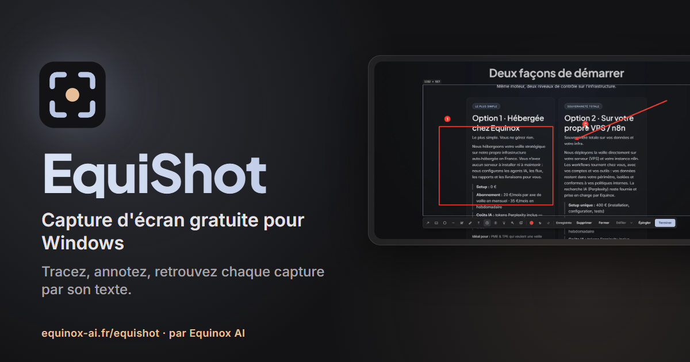
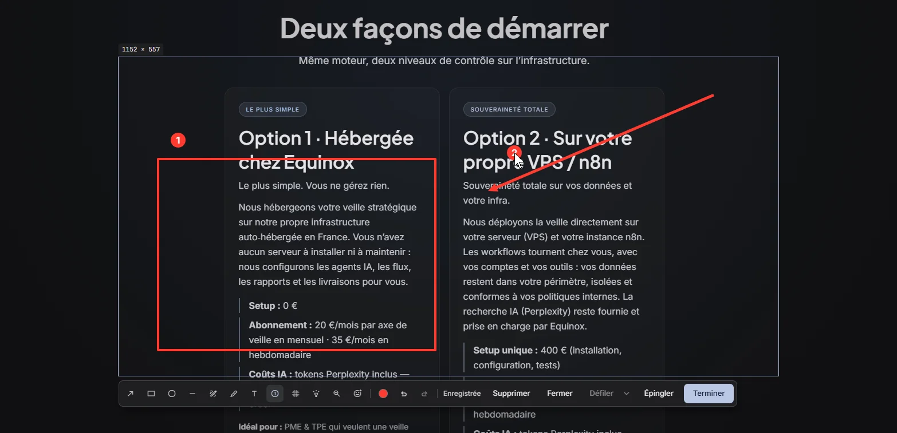
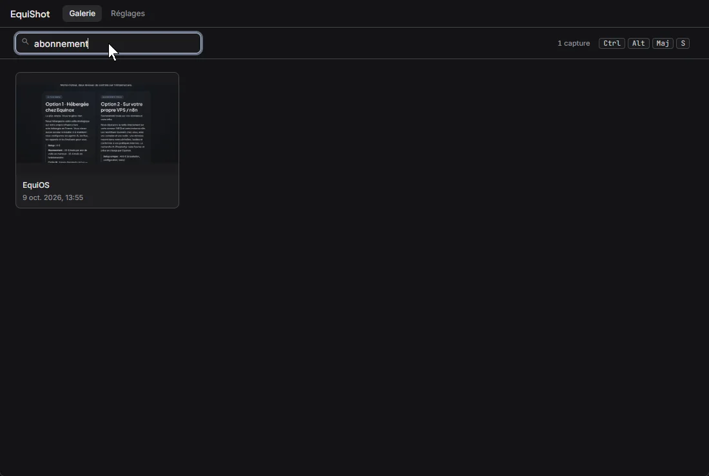

# EquiShot

La capture d'écran qui ne se perd plus. Application gratuite pour Windows 10 et 11, par
[Equinox AI](https://www.equinox-ai.fr). Sans compte, sans cloud, sans publicité.



**Télécharger l'installeur : [equinox-ai.fr/equishot](https://www.equinox-ai.fr/equishot)**

## Ce que fait EquiShot

- **Une pastille flottante** reste à l'écran sans voler la main aux autres fenêtres, et
  n'apparaît dans aucune capture ni aucun partage d'écran. Un raccourci clavier, ou un bouton de
  souris, lance la capture depuis n'importe quelle application.
- **La zone se trace sur l'écran vivant** : l'image n'est prise qu'au relâchement. Un clic sur une
  fenêtre la prend à son cadre exact, une loupe donne le pixel et la couleur, une page trop
  longue se capture en défilant.
- **Annoter sur place** : flèches, cadres, surligneur, texte, étapes numérotées, tampons,
  projecteur, pixellisation. La capture est déjà enregistrée et copiée, il ne reste qu'à coller.
  Une capture peut s'épingler devant les fenêtres.
- **Tout retrouver** : la galerie range chaque capture avec sa fenêtre, son application et sa
  note. La recherche lit aussi le texte des images, reconnu sur l'ordinateur par Windows.
- **Filmer une zone** : vidéo MP4 avec micro, son de l'ordinateur et bulle de caméra, GIF en
  option. Rien n'est envoyé.





## Vie privée

Aucune capture, aucune vidéo ne quitte l'ordinateur. Le texte des images est lu sur place par
l'OCR de Windows. Le seul échange avec internet est la vérification des mises à jour, une fois
par jour, sur `https://equinox-ai.fr/equishot/latest.json`. Les mises à jour sont signées et
vérifiées avant toute installation.

## Construire depuis les sources

Prérequis : Windows 10 version 2004 ou plus, Node.js 22 ou plus, la chaîne Rust (`rustup`, cible
MSVC) et WebView2 (fourni avec Windows 11).

```powershell
npm ci
npm run verify        # TypeScript, build Vite, tests unitaires Node, cargo test
npm run tauri build   # exe dans src-tauri\target\release\EquiShot.exe
```

Pour développer sans toucher à une installation existante, l'instance de développement a ses
propres données (`%APPDATA%\fr.equinox.equishot-dev`) et son propre raccourci
(`Ctrl+Alt+Shift+S`) :

```powershell
$env:EQUISHOT_INSTANCE = "dev"
npm run tauri dev
```

Un build local ne signe pas de mise à jour : seule la publication officielle le fait.

## Technique

Tauri 2, Rust (`xcap`, `windows-capture`, `rusqlite` avec FTS5, OCR `Windows.Media.Ocr`), React
19, TypeScript, Tailwind CSS 4. `src-tauri/vendor/windows-capture` est une copie de
[windows-capture](https://github.com/NiiightmareXD/windows-capture) (MIT) avec une méthode
ajoutée.

## Licence

[MIT](LICENSE).
